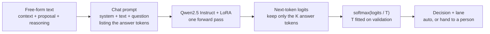

# Decision Reasoning Model (DRM)

A decision reasoning model reads free-form text (the context, a proposal and the reasoning behind
it) and returns one answer: a Yes/No probability, an ordered band, one of a few labels, or a
number with a spread. Same text in, same answer out, every time.

It's a small instruct LLM with a LoRA adapter. It never generates text. It runs one forward pass
and reads the logits of a few answer tokens at the next position, so there is no sampling and
nothing to drift between runs.

- The essay, with visuals: [Decision Reasoning Models](https://careychou.tech/writing/decision-reasoning-models)
- The short version on Medium: [Giving LLM Agents Precise Decisions](https://medium.com/p/106e08758afe)

## Why

We have used LLM agents for decisions, and the answers moved around: ask twice, get two answers.
That's fine for an open question where exploring is part of the value. It's a problem when the
same input should get the same decision and someone has to defend it later. Classic ML is
consistent, but it wants clean columns, and a lot of real decisions arrive as a paragraph.

A DRM is where we bridge the gap between LLM agents and classic ML. It reads text the way an
agent does and answers the way a model does: once, with a probability you can calibrate and a
threshold you can tune.

## How it works



1. Keep the instruct model as it is. Instruction tuning and RLHF already taught it to answer
   "Yes" or "No" (or "A", or "4") when asked, so it starts from a sensible prior.
2. End the prompt with a question that lists the answer tokens. Each answer must be one token:
   `Yes`/`No`, a letter, or a digit.
3. One forward pass. Read the logits for those K tokens at the last position and ignore the rest
   of the vocabulary.
4. Fine-tune with LoRA (about 1% of the weights) so those K logits match your labels.
5. Fit one temperature on validation so the probabilities mean what they say, then pick the
   thresholds where the model is allowed to act on its own.

For a binary task the maths is one line:

$$P(\text{Yes}\mid x) = \sigma\big(z_{Yes} - z_{No}\big) = \sigma\big((w_{Yes} - w_{No})^\top h(x)\big)$$

That's logistic regression on the last token's hidden state, with the weight vector borrowed from
the model's own output layer. LoRA changes how the transformer builds `h(x)` from the text.

## Four output shapes

A task says what it returns in `task.json` under `output`.

| shape | answer tokens | what you read | trained with | "sure enough to act" |
|---|---|---|---|---|
| binary | `No`, `Yes` | P(Yes) | cross-entropy | above the top line or below the bottom line |
| multiclass | `A`…`J` | top label + its probability | cross-entropy | top probability over a tuned cut |
| ordinal | `1`…`5` (or letters) | top band + expected band | cross-entropy, EMD, or both | same as multiclass |
| scalar | digits `0`…`8`, each a value | estimate Σ pₖvₖ and spread | two-hot cross-entropy, optional EMD | spread under a tuned cut |

EMD is the squared earth mover's distance between the predicted and target cumulative
distributions. It charges more for missing by two bands than by one. Two-hot puts a numeric
target between its two nearest bins so the expected value matches it exactly.

## Three examples

Each example has a synthetic data generator with a hidden rule, a `task.json`, a few sample rows
and a README.

| example | shape | question |
|---|---|---|
| [cosmetics-preference](examples/cosmetics-preference/) | ordinal, 5 bands | How much would she like this product? Score each candidate, sort by expected band. |
| [conference-attend](examples/conference-attend/) | binary | Would you attend this conference? |
| [travel-budget](examples/travel-budget/) | scalar, $1,000 to $3,000 | What should this trip cost? |

The generators render the same facts through many phrasings, sentence orders and layouts, so the
model has to read the text to find the rule. They write five splits:

| split | what it tests |
|---|---|
| `train`, `val` | learning and calibration (4% label noise) |
| `test` | same phrasing pool, new cases |
| `ood` | phrasing the model never saw in training |
| `perturb` | five rewordings of each case; how often does the answer flip? |

## Quickstart

```bash
python -m venv .venv && . .venv/bin/activate
pip install torch && pip install -r requirements.txt && pip install -e .

# 1. data
python examples/conference-attend/gen.py --out data/conference-attend

# 2. train (a single GPU is plenty for 1.5B; Apple MPS is fine for 0.5B)
python -m decision_model.train --model Qwen/Qwen2.5-1.5B-Instruct \
  --data data/conference-attend --task data/conference-attend/task.json --out outputs/conference

# 3. evaluate: calibration, auto-act thresholds, paraphrase flips, determinism
python -m decision_model.evaluate --model Qwen/Qwen2.5-1.5B-Instruct \
  --adapter outputs/conference/adapter --data data/conference-attend \
  --task data/conference-attend/task.json --out results/conference

# 4. score
mkdir -p models/conference && cp -r outputs/conference/adapter models/conference/ \
  && cp results/conference/metrics.json models/conference/
python -m decision_model.score --model-dir models/conference --text "Context: ..."
# {"p_yes": 0.68, "decision": "Yes", "route": "to_person"}
```

Or run all three examples, zero-shot and fine-tuned, in one go:

```bash
scripts/run_pipeline.sh
EXAMPLES="travel-budget" MODELS="Qwen/Qwen2.5-0.5B-Instruct" TRAIN_ARGS="--epochs 1" scripts/run_pipeline.sh
```

## What `evaluate.py` measures

- **Accuracy and calibration.** Accuracy, AUC for binary, ECE before and after the temperature;
  MAE and within-tolerance for scalar; within-one-band and EMD for ordinal.
- **Coverage at a precision.** Thresholds are chosen on validation so the automatic lanes hit a
  target precision (98% by default), then reported on test and OOD: how much the model can take
  on by itself.
- **Paraphrase flips.** Share of `perturb` groups where rewording the same case changed the answer.
- **Determinism.** The same 200 inputs scored three times, including batch size 32 against 1;
  reports the largest logit difference and the number of flipped decisions.

## Bring your own decision

1. Write `task.json`: a system prompt, a question that lists the answer tokens, and an `output`
   block (see the examples).
2. Write `train.jsonl`, `val.jsonl`, `test.jsonl`, `ood.jsonl` and `perturb.jsonl`, one row per
   line: `{"uid": ..., "text": ..., "label": <index>}`. Scalar rows also carry `"target"`;
   perturb rows carry `"group"`. `"kind"` is optional and splits the binary report by type.
3. Run train, evaluate and score as above.

The labels are the hard part. A DRM learns whatever your history of decisions teaches it, so the
quality and the consistency of those past decisions set the ceiling.

## Layout

```text
src/decision_model/
  common.py     prompt building, single-pass label-logit scoring
  heads.py      output shapes, soft targets, EMD, temperature, thresholds (pure Python)
  train.py      LoRA fine-tune on the K label logits
  evaluate.py   metrics, calibration, coverage, paraphrase flips, determinism
  score.py      load a trained model and score text (CLI + DecisionModel class)
  summarize.py  markdown table across runs
  synth.py      shared helpers for the synthetic generators
examples/       three worked tasks
scripts/        run_pipeline.sh
tests/          pytest, no GPU needed
```

## Credits

The single-pass, calibrated scoring idea follows
[Microsoft-Decision-1](https://commandline.microsoft.com/microsoft-decision-1-model-foundry/).
Base models are [Qwen2.5 Instruct](https://huggingface.co/Qwen). LoRA via
[PEFT](https://github.com/huggingface/peft).

## License

MIT. See [LICENSE](LICENSE).
